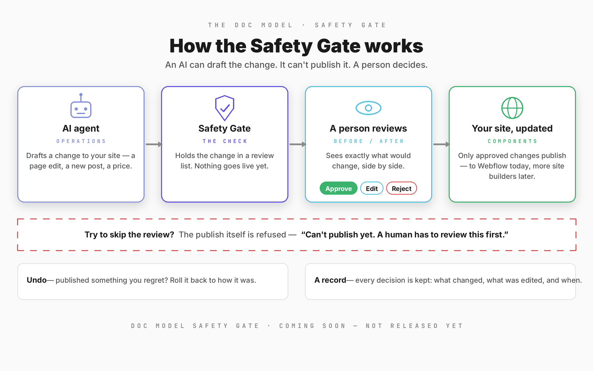

# DOC Model Safety Gate

**An AI can draft the change. It cannot publish it.**


The DOC Model builds software in three layers — **D**ata, **O**perations, **C**omponents. This MCP server enforces the DOC rule for AI agents working in the Operations layer: an agent can propose changes to your content, but every proposal is staged for human review, and only reviewed work can go live.

AI agents can write to your CMS the moment you connect them to it. This server puts a gate in between: everything an agent produces is staged for review, a human decides, and only reviewed work can go live. If an output is still pending, the publish call itself is refused — the gate is enforced by the backend, not by a warning label.



## The rule

1. **Propose** — a workflow runs in dry-run mode. Nothing can publish from a dry run.
2. **Stage** — AI outputs land in the Safety Gate with their original and proposed values, field by field.
3. **Review** — a human accepts, rejects, or edits each output. Bulk review is available for whole runs.
4. **Publish** — a live run is only permitted once its review run has no pending or rejected outputs. Attempting to publish early returns an error: *"Node … has pending AI output. Review all outputs before LIVE run."*
5. **Roll back** — a published run can be rolled back when snapshots exist.

## Tools

| Tool | What it does |
| --- | --- |
| `listPendingReviews` | List gate runs that still have outputs waiting for a decision. |
| `getGateReview` | Read one gate run's outputs: field, original value, AI value, status. |
| `reviewOutput` | Accept, reject, or edit a single output. |
| `bulkReviewOutputs` | Accept or reject every pending output in a run at once. |
| `publishReviewedRun` | Run a workflow live, gated on its review run. The review run ID is required — there is no way to call this "around" the gate. |
| `rollbackRun` | Roll a published workflow run back. |

The server also includes workflow inspection and graph tools for the Safety Gate API; the gate tools above are the supported launch surface (see Status).

## Quickstart

The server is a stdio MCP server that talks to a Safety Gate GraphQL API endpoint.

```bash
npx doc-model-safety-gate
```

Or from source:

```bash
npm install
npm run build
node dist/index.js
```

### Configuration

| Environment variable | Required | Purpose |
| --- | --- | --- |
| `DOCMODEL_API_ENDPOINT` | yes | GraphQL endpoint of the Safety Gate API, e.g. `http://localhost:4001/graphql` |
| `DOCMODEL_API_TOKEN` | yes | Bearer token sent to the API |
| `DOCMODEL_USER_ID` | yes | Identity the server acts as (sent as the `x-user-id` header) |
| `DOCMODEL_PROJECT_ID` | for member access | Project the server is scoped to (`x-project-id`) |
| `DOCMODEL_USER_ROLE` | no | `member` (default) or `admin` |

The older `STRATA_*` spellings of all five variables still work as fallback aliases.

### Claude Desktop / Cursor

```json
{
  "mcpServers": {
    "doc-model-safety-gate": {
      "command": "npx",
      "args": ["-y", "doc-model-safety-gate"],
      "env": {
        "DOCMODEL_API_ENDPOINT": "http://localhost:4001/graphql",
        "DOCMODEL_API_TOKEN": "your-token",
        "DOCMODEL_USER_ID": "your-user-id",
        "DOCMODEL_PROJECT_ID": "your-project-id",
        "DOCMODEL_USER_ROLE": "member"
      }
    }
  }
}
```

### Claude Code

```bash
claude mcp add doc-model-safety-gate \
  -e DOCMODEL_API_ENDPOINT=http://localhost:4001/graphql \
  -e DOCMODEL_API_TOKEN=your-token \
  -e DOCMODEL_USER_ID=your-user-id \
  -e DOCMODEL_PROJECT_ID=your-project-id \
  -- npx -y doc-model-safety-gate
```

## See it work

The loop at the top of this page is the real behavior, captured from a working local demo: an AI summary is proposed, staged in the Gate, and a publish attempted **before** review is refused by the backend; after the reviewer accepts, the identical call succeeds. The full build story — including the blocked publish, caught live — is told at [thedocmodel.com](https://thedocmodel.com).

The demo environment (Postgres + PostgREST + a mock CMS + the Safety Gate API) is not part of this repository; the server requires a Safety Gate API endpoint (see Status).

## Status

Pre-1.0 and under active packaging. Verified end-to-end against a local Safety Gate API on 2026-11-12: pending reviews list and open correctly, human review flips output status, unreviewed publishes are refused by the backend, and reviewed publishes execute. The server requires a Safety Gate API endpoint; a hosted endpoint is not part of this release.

## License

MIT — see [LICENSE](LICENSE). Use it, build on it, ship it commercially if you like; the hosted layer and the DOC Model name stay ours.

---

Built by Lacey Kesler. The DOC Model Safety Gate is the enforcement layer of the DOC Model (Data · Operations · Components) — taught at thedocmodel.com: AI proposes, humans decide, and the audit trail shows both.
